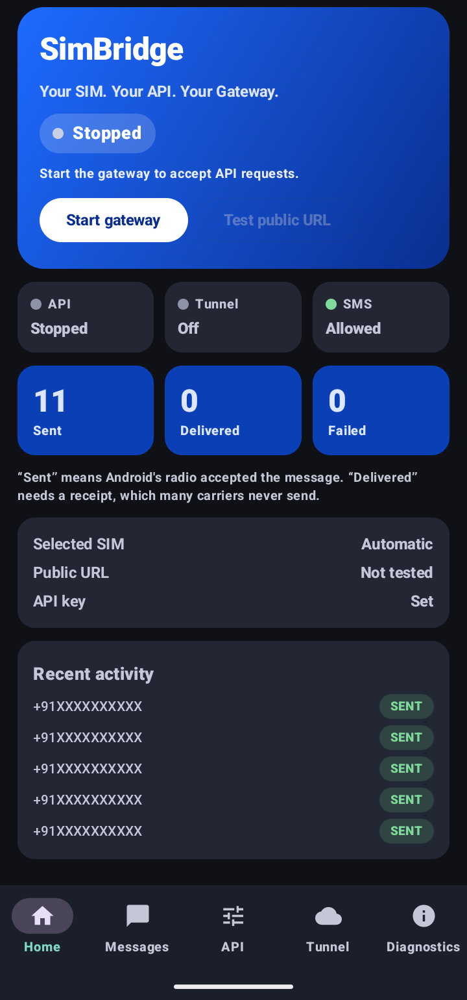
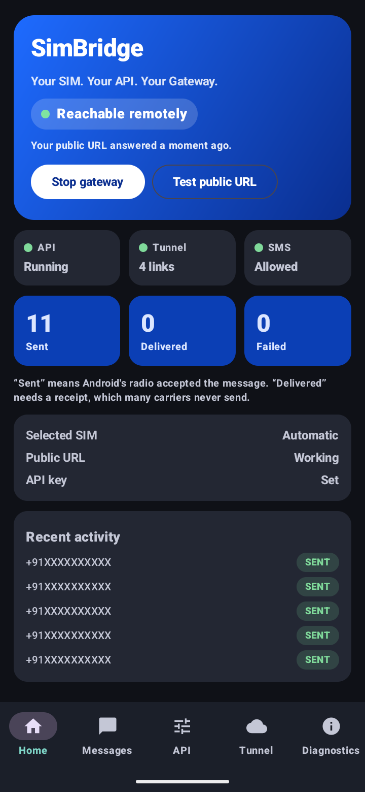
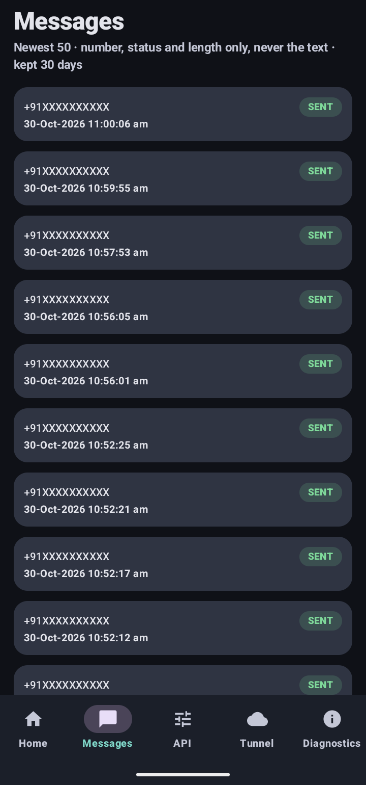
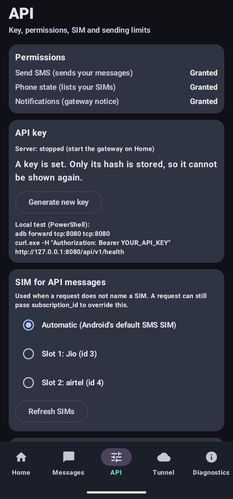
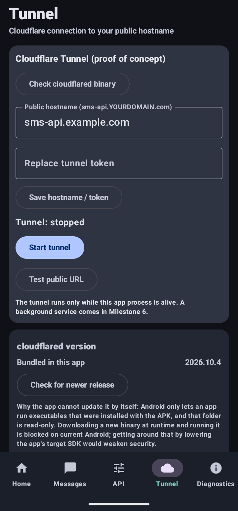
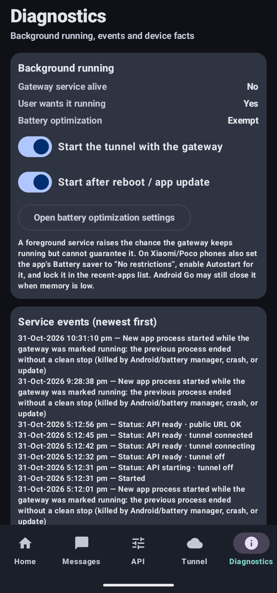
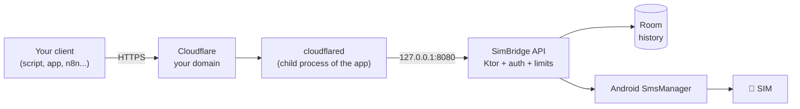

<div align="center">


# SimBridge Gateway

### Your SIM. Your API. Your Gateway.

Turn an Android phone with a SIM into a small, authenticated **SMS gateway** with a REST API and a built-in **Cloudflare Tunnel**.<br>
No root. No Termux. No separate server.

<br>

-3DDC84?logo=android&logoColor=white&style=for-the-badge)


[](https://github.com/GitHubsantu/simbridge-android/releases/latest)

<br>

[**⬇️ Download**](https://github.com/GitHubsantu/simbridge-android/releases/latest) · [**🚀 Quick start**](#-quick-start) · [**📖 API**](docs/API.md) · [**🌐 Cloudflare setup**](docs/CLOUDFLARE_SETUP.md) · [**🔒 Security**](docs/SECURITY.md)

</div>

---

## 📱 Screenshots

<div align="center">
<table>
  <tr>
    <td align="center"><br><sub><b>Home (stopped)</b><br>status, counters, recent activity</sub></td>
    <td align="center"><br><sub><b>Home (running)</b><br>API and tunnel online, ready for requests</sub></td>
    <td align="center"><br><sub><b>Messages</b><br>history, never the text</sub></td>
  </tr>
  <tr>
    <td align="center"><br><sub><b>API</b><br>key, permissions, SIM, limits</sub></td>
    <td align="center"><br><sub><b>Tunnel</b><br>Cloudflare hostname and token</sub></td>
    <td align="center"><br><sub><b>Diagnostics</b><br>background running, events, app update</sub></td>
  </tr>
</table>
</div>

*Phone numbers and the domain in these screenshots are masked.*

---

## ✨ Why SimBridge?

You already own a SIM with a good SMS plan. SimBridge lets your own software use it, safely, from anywhere.

| | |
|---|---|
| 🔐 **Authenticated by default** | Every endpoint needs a Bearer key. The key is shown once and only its SHA-256 is stored on the phone. |
| 🌍 **Reachable from anywhere** | Cloudflare Tunnel runs *inside* the app and exposes only `127.0.0.1:8080` on your own domain. No port forwarding, no VPS. |
| 📲 **Honest delivery status** | `SENT` and `DELIVERED` are tracked separately. A `202` means "accepted", never "delivered". |
| 🛡️ **Built to limit damage** | Per-minute/day limits, idempotency keys, destination allow-list, premium-number block, failed-auth throttling. |
| 🧩 **32-bit and 64-bit phones** | Separate APKs for 32-bit and 64-bit ARM, plus a universal one. Developed on a 32-bit Poco C51. |
| 🪶 **Minimal permissions** | Send SMS and read phone state. No READ_SMS, no RECEIVE_SMS, no contacts. Message text is never stored. |

## 🧭 How it works



SMS only. Built with **Kotlin, Jetpack Compose, Room and Ktor**.

## 🚀 Quick start

### 1. Install
Download the APK that matches your phone from the [**Releases page**](https://github.com/GitHubsantu/simbridge-android/releases/latest):

| File | Use on |
|---|---|
| `SimBridge-<version>-v7a-32bit.apk` | 32-bit userspace phones (e.g. Poco C51, many Android Go devices) |
| `SimBridge-<version>-v8a-64bit.apk` | 64-bit ARM phones (most modern phones) |
| `SimBridge-<version>-universal.apk` | Any ARM phone, when unsure (larger) |

<details>
<summary><b>Not sure which one? Verify the download?</b></summary>

With USB debugging on, run `adb shell getprop ro.zygote`: `zygote32` means the 32-bit APK, `zygote64_32` or `zygote64` means the 64-bit APK. A 64-bit CPU with a 32-bit userspace needs the **32-bit** APK. x86 phones and emulators are not supported.

Check the file against `SHA256SUMS.txt` from the release page:
```powershell
Get-FileHash .\SimBridge-1.1-v8a-64bit.apk -Algorithm SHA256
```
Install with `adb install -r <file>`, or open the APK on the phone and allow installs from your file manager or browser.
</details>

### 2. First run
1. **API tab → Grant permissions** (Send SMS, Phone state, Notifications).
2. **API tab → Generate key.** Copy it now: it is shown once and cannot be recovered.
3. **API tab → Sending limits:** set limits and **restrict destinations to your country prefix** (e.g. `+91`).
4. **Home → Start gateway.**

### 3. Send your first SMS (locally)
```powershell
adb forward tcp:8080 tcp:8080
curl.exe -H "Authorization: Bearer YOUR_API_KEY" http://127.0.0.1:8080/api/v1/health
```
```powershell
curl.exe -i -X POST http://127.0.0.1:8080/api/v1/messages `
  -H "Authorization: Bearer YOUR_API_KEY" -H "Content-Type: application/json" -H "Idempotency-Key: test-001" `
  -d '{\"to\":\"+91XXXXXXXXXX\",\"message\":\"SimBridge test\"}'
```
```json
{ "success": true, "message_id": "…", "status": "SUBMITTING", "message": "The message has been accepted for processing." }
```
Poll `GET /api/v1/messages/{id}` for `SENT` / `DELIVERED`. Full reference: [docs/API.md](docs/API.md).

### 4. Go public with Cloudflare Tunnel
Follow the [Cloudflare setup guide](docs/CLOUDFLARE_SETUP.md): create a named tunnel, point the public hostname **only** at `http://127.0.0.1:8080`, paste the token in the **Tunnel** tab, press Start, then **Test public URL**.
```powershell
curl.exe -i https://sms-api.YOURDOMAIN.com/api/v1/health                                        # expect 401
curl.exe -H "Authorization: Bearer YOUR_API_KEY" https://sms-api.YOURDOMAIN.com/api/v1/health   # expect 200
```
> **Tip:** "Tunnel connected" only means cloudflared registered. The URL test is the real proof. Add a Cloudflare WAF rate-limit rule, and ideally Cloudflare Access, in front of the hostname.

### 5. Keep it updated
- **From version 1.1:** open **Diagnostics → App update → Check for update**. The app reads this repository's latest release, downloads the APK for your phone, checks it against the published `SHA256SUMS.txt` and against its own signing key, then hands it to Android's installer. Nothing contacts GitHub until you press the button. Your API key hash, tunnel token and history are kept, and the gateway restarts after the update if it was running.
- **From 1.0:** version 1.0 has no updater, so install the 1.1 APK over it once by hand (same signing key, nothing is lost). After that, updates run inside the app.
- A debug build or a build signed with a different key cannot be updated this way; uninstall it first.

## 🔌 API at a glance

| Method | Path | What it does |
|---|---|---|
| `GET` | `/api/v1/health` | Server status |
| `GET` | `/api/v1/info` | Capabilities, SMS permission state, active limits |
| `POST` | `/api/v1/messages` | Queue one SMS (supports `Idempotency-Key`) |
| `GET` | `/api/v1/messages/{id}` | Status of one message |
| `GET` | `/api/v1/messages?limit=20&offset=0` | History, newest first (message text is never returned) |

Message lifecycle: `QUEUED → SUBMITTING → SENT | FAILED`, then `DELIVERED | DELIVERY_FAILED`.

## ✅ Status

| Feature | State |
|---|---|
| Loopback REST API, Bearer auth, `/api/v1` | ✅ Verified on a Poco C51 |
| Send SMS via a chosen SIM, separate `SENT`/`DELIVERED` | ✅ Real SMS verified (delivery receipts depend on your carrier) |
| Rate limits, idempotency, size limits, bounded queue | ✅ 429 and 202 verified on device; logic covered by automated tests |
| Cloudflare Tunnel, 32-bit and 64-bit ARM | ✅ Verified end to end on both |
| Foreground service, notification, 5-tab UI, event log | ✅ Used on device |
| Signed release APKs (32-bit, 64-bit, universal) | ✅ Built by script; each APK proven to contain the checksum-verified `libcloudflared.so`; signed with v1 + v2 + v3 |
| In-app update (1.1) | 🧪 Built with unit tests for version, APK and checksum handling; **not yet verified end to end on a phone** (needs a release newer than the installed one) |
| RCS, MMS, receiving SMS, multiple API keys, bulk send | ❌ Not implemented |

## 🔒 Security in short
- Server listens on **loopback only**; the tunnel is the only way in.
- 256-bit random key, only its **SHA-256** stored, constant-time comparison, never logged.
- Failed-auth throttling, send limits that survive restarts, idempotency keys, bounded queue.
- Premium and satellite prefixes blocked, plus your own country-prefix allow-list.
- Tunnel token encrypted with an Android Keystore key; screenshots blocked while a new key is on screen.
- In-app updates are manual, come only from this repository's releases, must match the published SHA-256 and be signed with the same key as the installed app, and still pass through Android's installer.
- No automatic SMS retries, no CORS, backups disabled.

Details and the full review log: [docs/SECURITY.md](docs/SECURITY.md). Found a problem? Please report it privately through **Security → Report a vulnerability**.

## ⚠️ Honest limitations
- `SENT` ≠ `DELIVERED`. A `202` only means the request was accepted.
- A foreground service raises the chance of running continuously but cannot guarantee it. Xiaomi/Poco and Android Go may stop apps: see [Troubleshooting](docs/TROUBLESHOOTING.md).
- One shared API key, no per-client scopes. Rotate it if it ever leaves your hands.
- The bundled `cloudflared` cannot be swapped on its own (Android forbids running downloaded executables). A new cloudflared means a new SimBridge release, installed by hand or through the in-app update, which replaces the whole APK.
- In-app updates use the repository's *latest* release only (pre-releases and drafts are ignored) and need the repository to be public.
- R8 minification is off for release builds. No dependency vulnerability scan has been run yet.
- A release APK and a debug build use different signing keys. Switching between them means uninstalling first, which deletes the app's data.
- Send only to people who consented, and follow your carrier's terms and local law.

## 🛠️ Build from source

<details>
<summary><b>Windows + Android Studio</b></summary>

**You need:** Windows PC, Android Studio (stable) with its bundled JDK, `adb`, and a 32-bit or 64-bit ARM phone with a SIM (minSdk 26). For remote access: a Cloudflare account, a domain and a named tunnel token.

```powershell
# 1. fetch the checksum-verified cloudflared builds (needed for the tunnel only)
powershell -ExecutionPolicy Bypass -File tools\fetch-cloudflared.ps1          # or: -Abi arm | -Abi arm64
# 2. unit tests
.\gradlew.bat test
# 3. build and install a debug build on the connected phone (USB debugging on)
.\gradlew.bat installDebug
```
The debug APK is **debuggable and signed with a debug key: for your own phone only, never distribute it.**

**Release APKs** (32-bit, 64-bit and universal) come from one command, after you create a signing key:
```powershell
powershell -ExecutionPolicy Bypass -File tools\build-release.ps1
```
It builds, checks that every APK contains the verified tunnel binary, and copies the files to `dist\`. `tools\make-release.ps1` then verifies the signatures, writes `SHA256SUMS.txt` and fills in the release notes. Full guide: [docs/RELEASE.md](docs/RELEASE.md).
</details>

## 📚 Documentation

| | |
|---|---|
| [Architecture](docs/ARCHITECTURE.md) | Packages, decisions, what is verified |
| [API](docs/API.md) | Endpoints, errors, idempotency |
| [Android setup](docs/ANDROID_SETUP.md) | Project and phone setup |
| [Cloudflare setup](docs/CLOUDFLARE_SETUP.md) | Tunnel, DNS, hardening |
| [Security](docs/SECURITY.md) | Checklist and review log |
| [Testing](docs/TESTING.md) | Automated tests, device and release checklists |
| [Troubleshooting](docs/TROUBLESHOOTING.md) | API, tunnel, install and build problems |
| [Release builds](docs/RELEASE.md) | Signing, APKs, publishing |
| [Reference analysis](docs/REFERENCE_ANALYSIS.md) · [Plan](docs/IMPLEMENTATION_PLAN.md) · [Changelog](CHANGELOG.md) | Project history |

## 📄 Licences
SimBridge is released under the **MIT License**, see [LICENSE](LICENSE). Third-party components and their licences, including the bundled Apache-2.0 `cloudflared` binary, are listed in [THIRD_PARTY_NOTICES.md](THIRD_PARTY_NOTICES.md). No code was copied from the two reference projects.

<div align="center">
<br>

**Made for people who want their own SIM to talk to their own software.**

</div>
